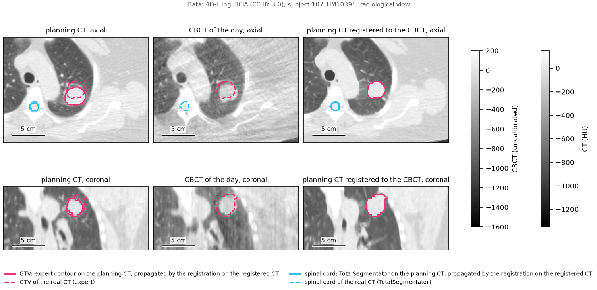
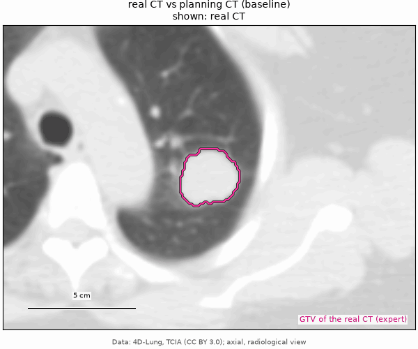
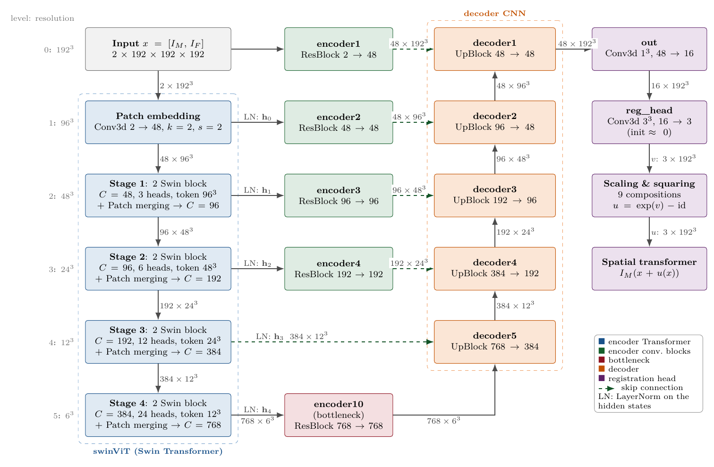
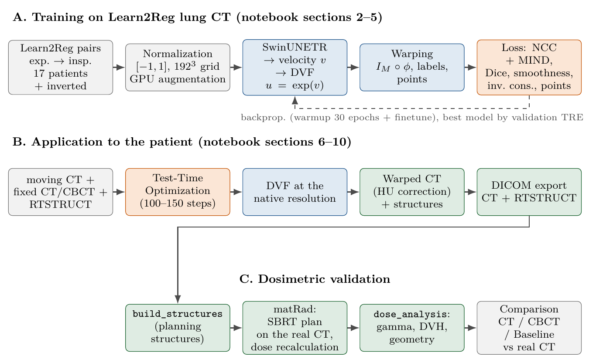
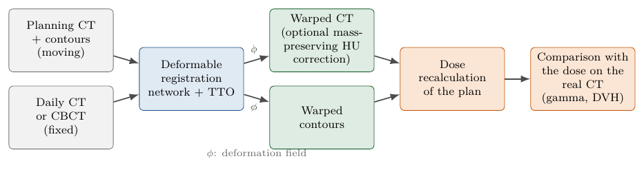
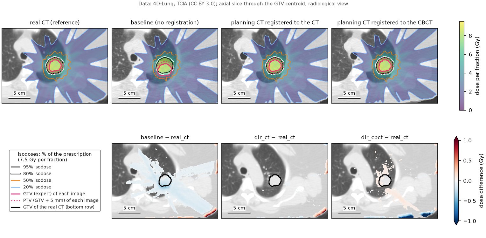
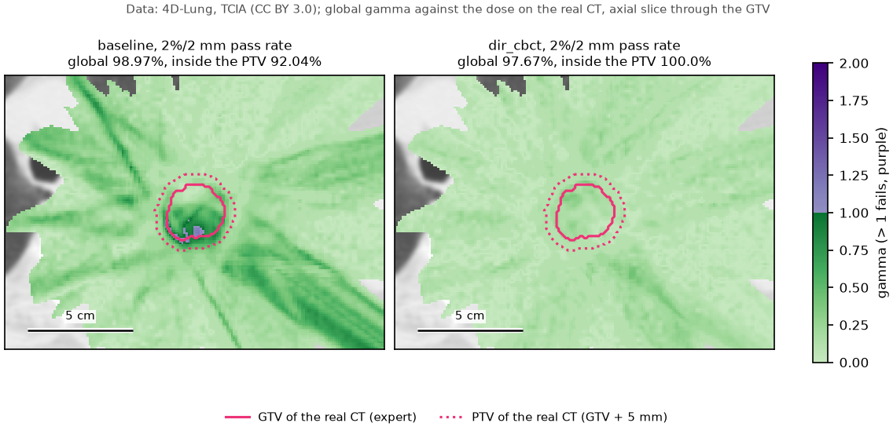

# Deep-learning deformable registration for adaptive radiotherapy

[](LICENSE)
[](pyproject.toml)
[](https://github.com/samkiwi18/adaptive-radiotherapy-dir/actions/workflows/ci.yml)

Diffeomorphic deformable registration of thoracic CT and CBCT with a SwinUNETR network, refined per patient by
test-time optimization, and the tools to check what the registration means for the dose: mass-preserving HU
correction, export of the warped CT and contours as DICOM, dose recalculation with matRad and comparison by gamma index,
DVH and structure geometry. It is meant for researchers in medical physics and image registration who want a complete,
inspectable pipeline from image pair to dosimetric evaluation, demonstrated on public data (Learn2Reg lung CT and the
TCIA 4D-Lung collection).



*The planning CT is registered onto the CBCT of a later day. Solid: GTV (expert contour) and spinal cord
(TotalSegmentator) of the planning CT, propagated by the registration in the right column; dashed: the same structures
on the real CT of that day. After registration solid and dashed contours coincide. Data: 4D-Lung, TCIA (CC BY 3.0),
subject 107_HM10395; axial and coronal slices through the GTV centroid, radiological view.*



*Same axial slice, alternating every second: real CT and planning CT (the tumor moves off the contour), real CT and
planning CT registered to it, CBCT and planning CT registered to the CBCT (the anatomy holds still). Contour: GTV of the
real CT (expert). Data: 4D-Lung, TCIA (CC BY 3.0); radiological view.*

## Features

- SwinUNETR with MONAI self-supervised encoder weights and a velocity head; scaling-and-squaring integration into a
  diffeomorphic displacement field.
- Training on Learn2Reg lung CT with MIND, NCC, soft Dice, inverse-consistency, smoothness, landmark and keypoint losses.
- Per-patient test-time optimization in two stages, with optional tumor, organ and bone supervision from RTSTRUCTs,
  held-out structures to monitor overfitting and a bone-rigidity check.
- Mass-preserving HU correction of the warped lung, export of the warped CT and contours as DICOM CT + RTSTRUCT.
- Command-line registration of a NIfTI pair (`scripts/register_pair.py`).
- matRad scripts for a fixed-plan dose recalculation, and a dosimetric comparison (gamma, DVH, Dice / HD95) of
  RTDOSE / RTSTRUCT sets.
- Memory-efficient window attention and activation checkpointing: the TTO peak on a 448 × 288 × 32 grid drops from
  15492.40 to 8857.77 MiB with equivalent results.



*The network: a Swin Transformer encoder and a convolutional decoder (MONAI SwinUNETR) followed by a 3×3×3 head that
outputs the velocity field; details in [`docs/architecture.md`](docs/architecture.md).*

## Installation

Python 3.11 or 3.12. From the repository root:

```bash
python3 -m venv .venv
source .venv/bin/activate
pip install -r requirements.txt
pip install -e ".[dosimetry,notebook,dev]"
pytest -q
```

`requirements.txt` pins the versions used for the reported results (PyTorch 2.13, MONAI 1.6.0); the CI installs the
latest CPU-only PyTorch and runs `ruff` and `pytest` on Python 3.11 and 3.12. Install the PyTorch build that matches
your GPU from [pytorch.org](https://pytorch.org).

## Pretrained weights

The trained registration network is published as an asset of the GitHub Release
[`v1.0`](https://github.com/samkiwi18/adaptive-radiotherapy-dir/releases/tag/v1.0):

| File | Size | MD5 | Content |
|---|---:|---|---|
| `best_reg_model.pth` | 256 MB | `79ef2c6f6664be5f5ec41b06e9df35c6` | SwinUNETR + velocity head, best validation TRE (11.85 mm) at the end of finetuning on Learn2Reg lung CT |

From the repository root:

```bash
curl -L -o weights/best_reg_model.pth \
  https://github.com/samkiwi18/adaptive-radiotherapy-dir/releases/download/v1.0/best_reg_model.pth
md5sum weights/best_reg_model.pth
```

`scripts/register_pair.py` (`--weights`) and the notebook (`WEIGHTS_PATH`) read it from `weights/best_reg_model.pth`. It
is the starting point of every test-time optimization. The MONAI self-supervised encoder weights, needed only to train
from scratch, are downloaded automatically ([`weights/README.md`](weights/README.md)).

## Quick start

Download the pretrained weights ([Pretrained weights](#pretrained-weights)), then get the Learn2Reg lung CT data (see
[Data](#data)) and register a test pair. In the LungCT release `_0001` is the moving and `_0000` the fixed image:

```bash
python scripts/register_pair.py \
    --moving data/LungCT/imagesTs/LungCT_0021_0001.nii.gz \
    --fixed data/LungCT/imagesTs/LungCT_0021_0000.nii.gz \
    --output_dir outputs/LungCT_0021 --low_memory
```

The script writes `warped.nii.gz`, the displacement field in voxels (`dvf.nii.gz`) and `jacobian_stats.json` (mean,
minimum and maximum of det J, folding percentage). With `--low_memory` (efficient attention and activation
checkpointing, [`docs/gpu_memory.md`](docs/gpu_memory.md)) the run above needs about 6 GB of RAM and a few minutes on a
CPU (indicative figures). Add `--tto` (with `--moving_mask` / `--fixed_mask` for the lung Dice term) to refine the
result with test-time optimization; `--steps`, `--lambda_reg` and `--device` control it. Use a GPU for it: on a CPU,
even a reduced 96³ grid takes about an hour (indicative).

## Full workflow



| Step | How | Details |
|---|---|---|
| Training on Learn2Reg | `notebooks/main.ipynb`, sections 3-5 (GPU) | [`docs/method.md`](docs/method.md#4-training) |
| Test-time optimization | notebook sections 6-7, or `scripts/register_pair.py --tto` | [`docs/method.md`](docs/method.md#5-test-time-optimization) |
| TTO with RTSTRUCT structures, HU correction, DICOM CT + RTSTRUCT export | notebook section 9 | [`docs/method.md`](docs/method.md#7-warped-structures-and-mass-preserving-hu-correction) |
| Planning structures | `python scripts/build_structures.py --ct_dir <CT slices + RTSTRUCT>` | [`scripts/README.md`](scripts/README.md) |
| Dose recalculation with a fixed plan | `matlab/compute_dose.m`, `matlab/export_dose.m` (matRad) | [`matlab/README.md`](matlab/README.md) |
| Dosimetric comparison | `python scripts/dose_analysis.py --input_dir <folder>` | [`scripts/README.md`](scripts/README.md) |
| GPU memory profiling | notebook section 10 | [`docs/gpu_memory.md`](docs/gpu_memory.md) |
| Figures of this README | `scripts/figures/make_case_figures.py` (from existing outputs), `make_plots*.py` | [`scripts/README.md`](scripts/README.md) |

The dosimetric comparison reads `RTDose_<case>.dcm` and `RTstruct_<case>.dcm` for the cases `real_ct` (reference),
`dir_ct`, `dir_cbct` and `baseline` (see [`docs/pipeline.md`](docs/pipeline.md)) and writes CSVs, a summary and plots to
`<folder>/results`:

```bash
python scripts/dose_analysis.py --input_dir data/clinical/4dlung_107/full_network
```

The notebook sets every path in its first code cell and writes the printed output of each section to the matching file
of `results/`.

## Data

**Learn2Reg lung CT** (public, [CC BY 4.0](https://creativecommons.org/licenses/by/4.0/)):

- training images and lung masks: *Learn2Reg Challenge: CT Lung Registration - Training Data*, Zenodo,
  [doi:10.5281/zenodo.3835682](https://doi.org/10.5281/zenodo.3835682) (`case_xxx_exp` / `case_xxx_insp` files);
- landmarks, keypoints and test pairs: the LungCT task of the Learn2Reg dataset
  ([learn2reg.grand-challenge.org](https://learn2reg.grand-challenge.org/)), `LungCT_dataset.json` release 1.11
  ([hering2022learn2reg](REFERENCES.md#hering2022learn2reg)).

The training point convention (x and y flipped, phases swapped) holds for the CSVs together with the `case_xxx`
images; with the `LungCT_xxxx` images of `imagesTr` no flip is needed (notebook section 2).

**4D-Lung case study** (public, TCIA): subject `107_HM10395` of the collection 4D-Lung
([hugo2016_4dlung_data](REFERENCES.md#hugo2016_4dlung_data), descriptor
[hugo2017_4dlung](REFERENCES.md#hugo2017_4dlung)), distributed under
[CC BY 3.0](https://creativecommons.org/licenses/by/3.0/) and the
[TCIA Data Usage Policy](https://www.cancerimagingarchive.net/data-usage-policies-and-restrictions/). It uses the
planning 4D fan-beam CT (series S300), a later 4D fan-beam CT (series S302, the reference `real_ct`) and a 4D CBCT
(series S107), all at the 0% phase, with the RTSTRUCTs of the two CTs. Series UIDs, download with `idc-index` or the
NBIA Data Retriever, and the expected layout are in [`data/README.md`](data/README.md).

No image data are included in this repository: both data sets are downloaded from their sources.

## Results

All numbers below are copied without rounding from the files in `results/` ([`results/README.md`](results/README.md)):
`results/training/` and `results/tto/` for Learn2Reg, `results/dosimetry/<run>/` for the 4D-Lung case study,
`results/vram_profiling/` for GPU memory, `results/case_figures.json` for the numbers in the figure captions. More
figures: [`docs/results.md`](docs/results.md).

### Learn2Reg lung CT

Validation TRE (mm, landmarks of 3 patients) of the training phases; no folding in any epoch:

| Phase | Best validation TRE | Epoch |
|---|---:|---:|
| no registration | 14.65 | – |
| warmup | 13.36 | 27 |
| finetune | 12.09 | 33 |
| finetune D | 11.86 | 23 |
| finetune E | 11.85 | 26 |

*Finetune D restarts from the best finetune model with the same rigid augmentation applied to moving and fixed (an
independent one added fake relative motion); finetune E also widens the rotations and translations. Training curves
are in [`docs/results.md`](docs/results.md).*

Test-time optimization on GPU, 120 steps, `lambda_reg = 0.5`, whole network. On the test pairs the keypoints are removed
from the TTO input and used only for evaluation; there the TTO increases the mean keypoint error.

| Group | Metric | No registration | Network | Network + TTO | TTO folding |
|---|---|---:|---:|---:|---:|
| validation (3 patients) | landmark TRE (mm) | 14.64 | 11.85 | 3.29 | 1.89% |
| test (9 pairs) | keypoint error (mm) | 11.18 | 10.54 | 11.98 | 0.04% |

Choice of the regularization weight (validation means):

| `lambda_reg` | TRE (mm) | folding, volume | folding, lungs |
|---:|---:|---:|---:|
| 0.01 | 3.07 | 5.95% | 1.00% |
| 0.5 | 2.98 | 2.20% | 0.09% |
| 2.0 | 3.38 | 0.05% | 0.00% |

The same configuration (`lambda_reg = 0.5`) gives a mean validation TRE of 3.29 mm in the first table and 2.98 mm in
the second: the TTO is not deterministic on the GPU, and repeated runs differ.

### 4D-Lung case study



Subject `107_HM10395` of 4D-Lung. The planning CT is registered onto the later CT (`dir_ct`) and onto the CBCT
(`dir_cbct`); `baseline` is the planning CT without registration, and the reference `real_ct` is the later CT with its
own contours. One matRad plan (60 Gy in 8 fractions, 7.5 Gy per fraction) is optimized on `real_ct` and recalculated with
the same beams and weights on the other anatomies. Doses were computed on a 3 × 3 × 3 mm grid (the dose grid stored in
the plan, `results/dosimetry/treatment_plan.txt`) and exported on the CT grid, 0.9766 × 0.9766 × 3 mm (`PixelSpacing`,
`GridFrameOffsetVector` step and `SliceThickness` of every RTDOSE file of both runs). The mass-preserving HU
correction was used for one registered dose only, `dir_ct` of `frozen_backbone`; the other registered doses were
computed on the warped CT without it (row "HU of the warped CT" in the tables below,
[`docs/method.md`](docs/method.md#8-dicom-ct-and-rtstruct-export)). Two TTO variants are reported: in
`frozen_backbone` the whole SwinUNETR (encoder, decoder and its 1×1×1 output convolution, 62,189,122 parameters) is
frozen and only the 3×3×3 velocity head `reg_head` (1,299 parameters) is optimized; in `full_network` all 62,190,421
parameters are optimized. The registration onto the CBCT is shown at the top of this README.

#### Contours

| Structure | Source | Image | Role in the TTO | Role in the evaluation |
|---|---|---|---|---|
| GTV | 4D-Lung, expert radiation oncologist | planning CT, real CT | Dice term | reference (geometry, DVH, gamma) |
| organs at risk and bones (lungs, heart, vessels, esophagus, trachea, spinal cord, back muscles, vertebrae, ribs, scapulae, clavicles, sternum, costal cartilage) | TotalSegmentator 2.14.0 (installed version at the time of writing), task `total` ([wasserthal2023totalsegmentator](REFERENCES.md#wasserthal2023totalsegmentator)) | planning CT, real CT | organ and bone Dice terms; smaller vessels, left atrial appendage, back muscles, costal cartilage and right ribs 1-7 held out | references of the organs at risk |
| PTV, Lungs-GTV, SpinalCord_PRV5, Heart_total, GreatVessels, ChestWall, Ring_PTV_10-30mm, BODY | `scripts/build_structures.py` | planning CT, real CT, registered CTs | not used | planning and evaluation |

In both registrations the fixed labels of the TTO are the structures of the real CT: 4D-Lung has no contours on the
CBCT. Details in [`data/README.md`](data/README.md#contours).

Geometry against the contours of the real CT:

| Structure | Metric | baseline | dir_ct, frozen backbone | dir_cbct, frozen backbone | dir_ct, full network | dir_cbct, full network |
|---|---|---:|---:|---:|---:|---:|
| GTV | Dice | 0.458 | 0.928 | 0.881 | 0.978 | 0.984 |
| GTV | HD95 (mm) | 9.392 | 1.953 | 3.0 | 0.977 | 0.977 |
| GTV | centroid shift (mm) | 9.684 | 0.276 | 1.223 | 0.072 | 0.075 |
| PTV | Dice | 0.614 | 0.943 | 0.918 | 0.984 | 0.989 |
| SpinalCord_PRV5 | Dice | 0.898 | 0.831 | 0.729 | 0.976 | 0.974 |
| Lungs-GTV | Dice | 0.933 | 0.942 | 0.92 | 0.979 | 0.979 |

These structures are also in the TTO loss with the contours of the real CT as targets, so their Dice is optimistic
(see [Limitations](#limitations)).

D98 relative to the dose on the real CT (%, each dose with its own structures):

| Structure | baseline | dir_ct, frozen backbone | dir_cbct, frozen backbone | dir_ct, full network | dir_cbct, full network |
|---|---:|---:|---:|---:|---:|
| HU of the warped CT | original | corrected | uncorrected | uncorrected | uncorrected |
| GTV | -37.49 | -1.53 | -2.09 | -0.23 | 0.37 |
| PTV | -46.24 | -6.13 | -19.95 | 0.06 | 0.82 |



*The dose distributions differ little, because the plan is the same and only the densities change (bottom row,
differences shown where the real CT dose is at least 10% of its maximum and inside the real CT BODY, the same region as
the gamma analysis). The baseline fails because the target has moved relative to the dose, not because the dose
changed: in the top row its GTV lies partly outside the 95% isodose (D98 −37.49%), while on the registered CT and CBCT
it sits inside as on the real CT. Each case is evaluated with its own contours: top row, GTV (expert) and PTV
(GTV + 5 mm) of each image; bottom row, GTV of the real CT. `full_network`; data: 4D-Lung, TCIA (CC BY 3.0); axial
slice through the GTV centroid, radiological view.*

Gamma pass rate (%) against the dose on the real CT, global, 10% low-dose cutoff:

| Criterion | baseline | dir_ct, frozen backbone | dir_cbct, frozen backbone | dir_ct, full network | dir_cbct, full network |
|---|---:|---:|---:|---:|---:|
| HU of the warped CT | original | corrected | uncorrected | uncorrected | uncorrected |
| 3%/3 mm | 99.53 | 99.78 | 98.79 | 99.8 | 98.59 |
| 2%/2 mm | 98.97 | 99.46 | 97.87 | 99.51 | 97.67 |
| 2%/2 mm inside the GTV | 86.66 | 99.98 | 100.0 | 100.0 | 100.0 |
| 2%/2 mm inside the PTV | 92.04 | 99.74 | 100.0 | 100.0 | 100.0 |
| 2%/2 mm where dose ≥ 80% of the maximum | 90.15 | 99.68 | 100.0 | 100.0 | 100.0 |



*The global pass rate does not separate the cases (baseline 98.97%) and is lower for the registered CBCT (97.67%)
because of the body edge, where the CBCT field of view cuts the body (99.61% at 3 mm or more from the edge,
`dose_comparison_regions.csv`). Inside the target the registered CBCT passes 100%, the baseline 92.04% in the PTV, with
its failing points (purple) on the tumor. Both panels show the GTV (expert, solid) and the PTV (dotted) of the real CT,
the structures in which the pass rates are computed (`gamma_results.csv`, `gamma_in_structures.csv` of
`results/dosimetry/full_network/`). Data: 4D-Lung, TCIA (CC BY 3.0); axial slice through the GTV centroid, radiological
view.*

DVHs, per-structure geometry and dose metrics of both experiments: [`docs/results.md`](docs/results.md#4d-lung-case-study).

### GPU memory of the 4D-Lung TTO

NVIDIA A100, 448 × 288 × 32 grid ([`docs/gpu_memory.md`](docs/gpu_memory.md)):

| Setup | Peak, whole network (MiB) | Step (s) | Peak, frozen backbone (MiB) |
|---|---:|---:|---:|
| MONAI window attention | 15492.40 | 0.74 | 9456.87 |
| efficient attention + activation checkpointing | 8857.77 | 1.02 | 5481.56 |

## Limitations

- **One patient.** The dosimetric results come from a single lung SBRT case study (4D-Lung subject 107_HM10395) and do
  not support general conclusions.
- **CBCT upper bound.** 4D-Lung has no contours on the CBCT, and TotalSegmentator contours on the CBCT were not reliable
  enough to be used, so in the CBCT case the TTO uses the structures of the real CT as fixed labels; the same structures
  are the reference of the geometric evaluation. The CBCT results are an upper bound: in practice the contours of the
  day are what the registration has to provide.
- **Automatic references.** The geometric metrics of the organs at risk are computed against TotalSegmentator contours,
  not expert contours; only the GTV reference is an expert contour. They were generated with TotalSegmentator 2.14.0
  (installed version at the time of writing; nnU-Net 2.8.1), task `total` (CT), run on CPU in the 3D Slicer 5.12
  SlicerTotalSegmentator extension; fast mode not recorded. The `total` task needs no license key and is released
  under Apache-2.0.
- **HU correction.** Three of the four registered doses (`dir_cbct` of `frozen_backbone`, both of `full_network`) were
  recalculated on the warped CT without the mass-preserving HU correction, so their dose differences do not include
  its effect, and the two experiments are not compared on equal terms for `dir_ct`.
- **Field of view.** The CBCT has a circular field of view that cuts the body contour, and every volume of the case has
  only 32 slices of 3 mm (9.6 cm cranio-caudal). Structures at the border, for example the T7 and T8 vertebrae, are
  truncated differently in moving and fixed images, and their metrics are not meaningful.
- **Variability.** The TTO is not deterministic on the GPU: repeated runs differ by about 2 mm in mean DVF
  (`results/vram_profiling/attention_quality.txt`).
- **Generalization.** With 17 training patients the network alone reduces the validation TRE from 14.65 to 11.85 mm;
  most of the accuracy comes from the per-patient TTO, which did not reduce the keypoint error on the Learn2Reg test
  pairs.
- **Dose engine.** The plan uses the matRad pencil-beam engine on a 3 mm dose grid, less accurate than Monte Carlo in
  lung; a Monte Carlo recalculation of the same plan is future work.
- **Not for clinical use.** This is research code, not validated or certified for patient treatment; clinical use of
  deformable registration requires the commissioning and quality assurance described by AAPM TG-132
  ([brock2017tg132](REFERENCES.md#brock2017tg132)).

## Repository structure

```
adaptive-radiotherapy-dir/
├── registration/           Python package: model, losses, metrics, training, TTO, HU correction, DICOM export
│   └── dose_analysis/      planning structures and dose / gamma / DVH comparison
├── scripts/                register_pair.py, build_structures.py, dose_analysis.py; figures/ rebuilds the figures
├── notebooks/main.ipynb    training, TTO, keypoints, 4D-Lung export, GPU profiling (outputs cleared)
├── matlab/                 matRad scripts: plan, dose recalculation, export
├── tests/                  CPU unit tests (pytest)
├── docs/                   method, architecture, GPU memory, pipeline, additional results, figures
├── results/                logs, CSVs and summaries of the reported experiments
├── weights/                how to get the trained and the self-supervised weights
├── data/                   expected data layout and download instructions (data not included)
├── .github/workflows/      CI: ruff and pytest on Python 3.11 and 3.12
├── REFERENCES.md, references.bib, CITATION.cff, CHANGELOG.md, NOTICE, LICENSE
└── pyproject.toml, requirements.txt
```

## Citation and references

To cite this software, use [`CITATION.cff`](CITATION.cff) (GitHub shows it as "Cite this repository"). The sources
cited in this README and in `docs/`, with verified DOIs and arXiv identifiers, are in [`REFERENCES.md`](REFERENCES.md)
(BibTeX: [`references.bib`](references.bib)). If you use the 4D-Lung case study, cite the data set and its descriptor
([hugo2016_4dlung_data](REFERENCES.md#hugo2016_4dlung_data), [hugo2017_4dlung](REFERENCES.md#hugo2017_4dlung)) and
[balik2013_4dct_4dcbct](REFERENCES.md#balik2013_4dct_4dcbct), as the collection page asks.

## Acknowledgements

<!-- Supervisor(s): TODO -->
<!-- University and department: TODO -->

The 4D-Lung investigators (Hugo, Weiss, Sleeman, Balik, Keall, Lu, Williamson) and The Cancer Imaging Archive
([clark2013_tcia](REFERENCES.md#clark2013_tcia)) for the case-study data; the Learn2Reg organizers for the lung CT data
([hering2020learn2reg_lung_data](REFERENCES.md#hering2020learn2reg_lung_data)). Built with MONAI
([cardoso2022monai](REFERENCES.md#cardoso2022monai), [monai_software](REFERENCES.md#monai_software)), PyTorch
([paszke2019pytorch](REFERENCES.md#paszke2019pytorch)), matRad ([matrad_software](REFERENCES.md#matrad_software)), pydicom
([pydicom_software](REFERENCES.md#pydicom_software)), NiBabel ([nibabel_software](REFERENCES.md#nibabel_software)),
pymedphys ([biggs2022pymedphys](REFERENCES.md#biggs2022pymedphys)) and TotalSegmentator
([wasserthal2023totalsegmentator](REFERENCES.md#wasserthal2023totalsegmentator)).

## Use of AI assistance

The code was written with the assistance of an AI coding assistant (Claude). The scientific design, the
methodological choices and the validation are the author's.

## License

Code and documentation: [Apache License 2.0](LICENSE), copyright 2026 Samuele Caggia; third-party material is listed in
[`NOTICE`](NOTICE).

- **4D-Lung**: not included. Distributed by TCIA under the
  [Creative Commons Attribution 3.0 Unported](https://creativecommons.org/licenses/by/3.0/) license and the
  [TCIA Data Usage Policy](https://www.cancerimagingarchive.net/data-usage-policies-and-restrictions/). The case-study
  figures (`docs/figures/case_*`) and the numbers in `results/dosimetry/` are derived from it.
- **Organ-at-risk contours** of the case study: generated with TotalSegmentator
  ([wasserthal2023totalsegmentator](REFERENCES.md#wasserthal2023totalsegmentator)); they are not part of 4D-Lung and
  are not included.
- **Learn2Reg lung CT**: not included; [CC BY 4.0](https://creativecommons.org/licenses/by/4.0/). The keypoint
  overlays in `results/keypoints/` are derived from it.
- **matRad** (GPL-3.0) and the **MONAI self-supervised weights** are not included and keep their own licenses.
