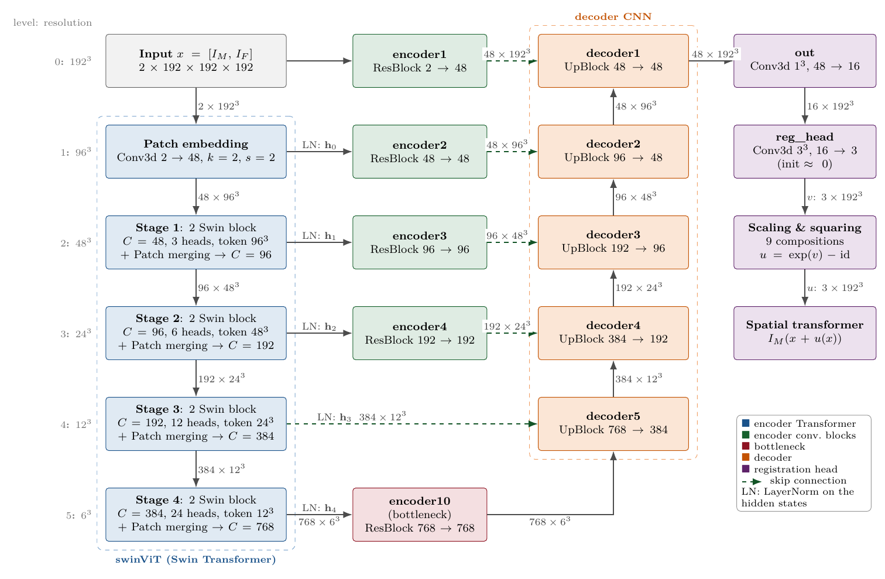
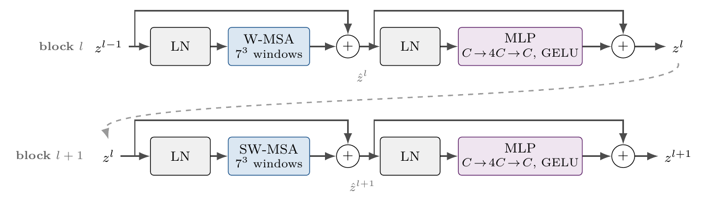
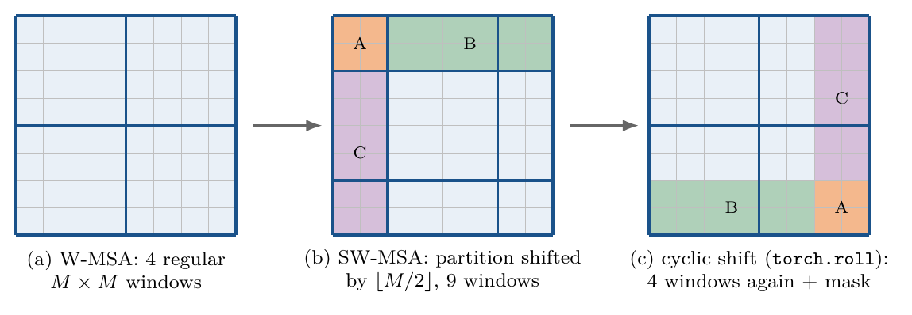

# Network architecture

The registration network is the MONAI `SwinUNETR`
([hatamizadeh2022swinunetr](../REFERENCES.md#hatamizadeh2022swinunetr)) followed by a small convolutional head that
predicts a stationary velocity field. Code: `registration/model.py` (`PretrainedSwinUNETR_Reg`, `build_model`,
`build_components`, `predict_dvf`).



*Tensor shapes (channels × volume, batch omitted) for a 192³ input with `feature_size = 48`.*

## Why a Swin Transformer

Convolutional encoders such as the U-Net ([ronneberger2015unet](../REFERENCES.md#ronneberger2015unet)) grow their
receptive field slowly, while breathing motion of the diaphragm can reach 1-2 cm and depends on distant structures.
Self-attention ([vaswani2017attention](../REFERENCES.md#vaswani2017attention)) relates all tokens to each other, but its
cost grows with the square of the number of tokens: a 192³ volume split into 2³ patches gives 96³ ≈ 8.8·10⁵ tokens.
The Vision Transformer ([dosovitskiy2021vit](../REFERENCES.md#dosovitskiy2021vit)) and UNETR
([hatamizadeh2022unetr](../REFERENCES.md#hatamizadeh2022unetr)) avoid this with large patches, at the cost of resolution.
The Swin Transformer ([liu2021swin](../REFERENCES.md#liu2021swin)) keeps the cost linear with three ideas: attention
inside local windows of M³ tokens, windows shifted by ⌊M/2⌋ in every other block so that information crosses window
borders, and patch merging between stages, which builds a multi-scale hierarchy as in a CNN. Swin encoders have also
been used for registration by TransMorph ([chen2022transmorph](../REFERENCES.md#chen2022transmorph)).

## Input and patch embedding

- The moving and fixed images, normalized to [-1, 1], are concatenated along the channels (early fusion):
  `x = [I_M, I_F]`, 2 × D × H × W. Every spatial dimension must be divisible by 32 (one factor 2 for the patch
  embedding and one for each of the four patch merging steps): the training grid is 192³.
- The patch embedding is a 3D convolution with kernel and stride 2 (2 → 48 channels): each token is a linear combination
  of the 8 voxels × 2 channels of its patch. There is no absolute position embedding.
- The self-supervised weights ([tang2022selfsupervised](../REFERENCES.md#tang2022selfsupervised); the MONAI
  documentation associates the released file with [valanarasu2023disruptive](../REFERENCES.md#valanarasu2023disruptive)) have a 1-channel
  patch embedding `W_ssl`. It is copied to both channels and divided by 2, so at the start the transformer sees only the
  mean of the two images. For this reason the patch embedding stays trainable during the warmup, when the rest of the
  transformer is frozen (see [`method.md`](method.md#4-training)).

## Swin blocks

Each of the four stages has two consecutive Swin blocks (pre-norm residual units):

```
ẑ^l     = W-MSA(LN(z^(l-1))) + z^(l-1)          z^l     = MLP(LN(ẑ^l)) + ẑ^l
ẑ^(l+1) = SW-MSA(LN(z^l)) + z^l                 z^(l+1) = MLP(LN(ẑ^(l+1))) + ẑ^(l+1)
```



- **Window attention** (`WindowAttention`): inside each window of n = 7³ = 343 tokens, query, key and value come from
  one `Linear(C, 3C)`; with h heads of dimension d = C/h = 16,
  `head_i = SoftMax(Q_i K_iᵀ / √d + B_i) V_i`. `B_i` is a learned relative position bias, read from a table of
  (2M − 1)³ = 2197 rows per head indexed by the offset between the two tokens.
- **LayerNorm** ([ba2016layernorm](../REFERENCES.md#ba2016layernorm)) normalizes each token over its channels and does
  not depend on the batch (batch size 1 here).
- **MLP**: `Linear(C, 4C)` → GELU ([hendrycks2016gelu](../REFERENCES.md#hendrycks2016gelu)) → `Linear(4C, C)`, applied to
  each token.

| Stage | Channels / heads | Tokens (192³ input) | Windows (tokens per window) |
|---|---|---|---|
| patch embedding | 48 / – | 96³ | – |
| 1 | 48 / 3 | 96³ | 14³ = 2744 (343) |
| 2 | 96 / 6 | 48³ | 7³ = 343 (343) |
| 3 | 192 / 12 | 24³ | 4³ = 64 (343) |
| 4 | 384 / 24 | 12³ | 2³ = 8 (343) |
| bottleneck | 768 / – | 6³ | – |

## Shifted windows and attention mask



*2D analogue with 8 × 8 tokens and M = 4. In 3D the windows have 7³ tokens and the shift is 3 tokens.*

The shifted partition creates irregular windows at the borders. The implementation rolls the token grid by −⌊M/2⌋
along each axis (`torch.roll`), so the windows are regular again. A mask adds −100 to the attention logits between
tokens that come from different sub-regions (strips A, B, C), which makes their weight practically zero after the
SoftMax. The roll is undone after the attention. When a dimension of the token grid is not larger than the window,
MONAI reduces the window to that dimension and does not shift along it. This happens on thin volumes, for example in
stages 3 and 4 of the 448 × 288 × 32 grid of the 4D-Lung case.

## Patch merging and hidden states

At the end of each stage the tokens of each 2 × 2 × 2 block are concatenated (8C channels), normalized with LayerNorm
and projected to 2C channels by a linear layer without bias. The resolution halves along each axis and the channels
double. The encoder returns five hidden states `h0`-`h4` (48, 96, 192, 384 and 768 channels at 96³, 48³, 24³, 12³ and
6³ for a 192³ input), each normalized by a LayerNorm without parameters before it reaches the decoder.

## Convolutional encoder, bottleneck and decoder

- `encoder1` (2 → 48) works directly on the input at full resolution: it is the only path that brings full-resolution
  detail to the decoder. `encoder2`-`encoder4` refine `h0`-`h2`; `h3` goes to the decoder directly.
- All these blocks are residual units: two 3³ convolutions without bias, instance normalization without affine
  parameters ([ulyanov2016instancenorm](../REFERENCES.md#ulyanov2016instancenorm)) and leaky ReLU (slope 0.01), with a
  1³ convolution on the shortcut when the channels change.
- The bottleneck `encoder10` (768 → 768) works on `h4` at 1/32 of the resolution. With about 31.9 M parameters it is
  more than half of the network.
- Five up-blocks (`decoder5`-`decoder1`) double the resolution with a transposed convolution (kernel and stride 2),
  concatenate the skip connection of the same level and fuse the two with a residual unit.

## Output and velocity head

The SwinUNETR output block is a 1³ convolution (48 → 16 channels). The registration head added on top is

```python
self.reg_head = nn.Conv3d(16, 3, kernel_size=3, padding=1)
```

which outputs the velocity field `v` (one component per axis, in voxels), with no final activation. It is initialized
with weights drawn from N(0, (10⁻⁵)²) and zero bias (`zero_init_output`), so that at the start `v ≈ 0` and the
deformation is the identity. The head has 16 · 3 · 27 + 3 = 1299 parameters. With a frozen backbone the velocity can only
be a local linear combination of the 16 feature maps, which limits what test-time optimization of the head alone can
correct ([`method.md`](method.md#5-test-time-optimization)).

`v` is integrated by scaling and squaring into the displacement `u` and the moving image is warped by a spatial
transformer ([`method.md`](method.md#2-diffeomorphic-integration-and-warping)).

## Parameters

| Component | Parameters | Share |
|---|---:|---:|
| `swinViT` (patch embedding + 4 stages) | 8,062,386 | 13.0% |
| `encoder1`-`encoder4` | 2,677,632 | 4.3% |
| `encoder10` (bottleneck) | 31,850,496 | 51.2% |
| `decoder5`-`decoder1` | 19,597,824 | 31.5% |
| `out` | 784 | < 0.01% |
| `reg_head` | 1,299 | < 0.01% |
| **Total** | **62,190,421** | 100% |

## Implementation notes

- `SwinUNETR` is built with `use_checkpoint=True`, so the Swin blocks are recomputed in the backward pass.
- All network computations run in bfloat16 mixed precision (`autocast_bf16`); numerically sensitive operations, such
  as the local variances of the NCC, are forced to float32.
- `set_window_attention` and `set_activation_checkpointing` reduce GPU memory without changing parameters or
  checkpoints: see [`gpu_memory.md`](gpu_memory.md). `set_window_attention` replaces MONAI internals and warns when the
  installed MONAI version differs from the tested one (1.6).
- MONAI reads the relative position bias as `relative_position_index[:n, :n]` even when a window is reduced on thin
  volumes, so the bias assigned to a token pair is not that of its true offset there. The efficient attention keeps
  the same indexing on purpose, so that trained weights and results do not change.
