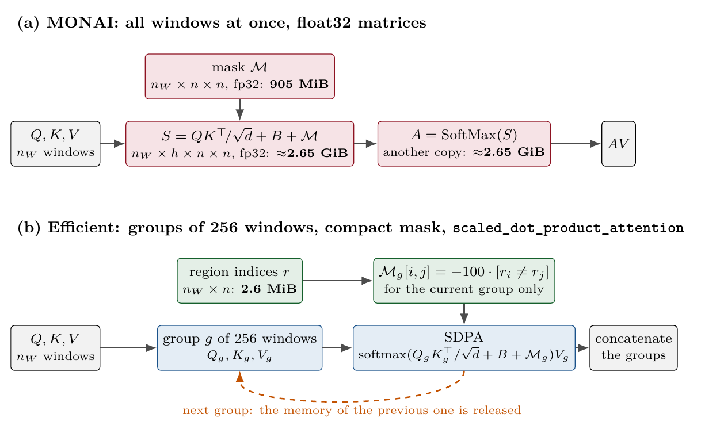
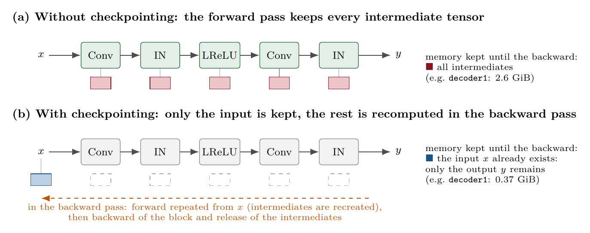
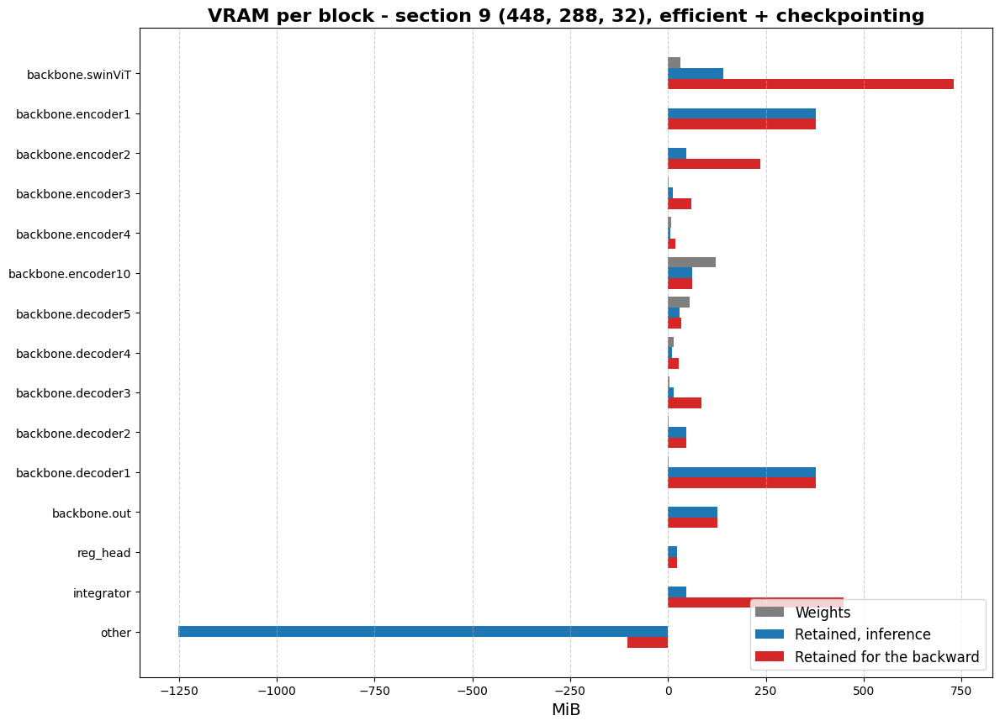

# GPU memory: efficient attention and activation checkpointing

Test-time optimization of the whole network on the 448 × 288 × 32 grid of the 4D-Lung case peaks at 15492.40 MiB with
the MONAI attention, at the limit of 16 GB GPUs. Two changes that keep parameters and saved checkpoints bring it to
8857.77 MiB with equivalent results. Code: `registration/model.py` (`set_window_attention`, `set_activation_checkpointing`) and
`registration/profiling.py`. Measurements: `results/vram_profiling/` (NVIDIA A100). In the notebook, `LOW_VRAM = True`
turns both changes on.

## Where the memory goes

In one optimization step `M_peak ≈ M_base + M_grad + M_Adam + M_activations`:

- `M_base`: what is already allocated (weights in float32: 62.19 M × 4 B ≈ 237 MiB, images, masks, structures);
- `M_grad`: one gradient per trainable parameter (237 MiB for the whole network, ~0 with a frozen backbone);
- `M_Adam`: two moments per trainable parameter (474 MiB);
- `M_activations`: tensors that the forward pass keeps for the backward pass, plus temporaries. This is by far the
  largest term: weights, gradients and optimizer states together are below 1 GiB.

Orders of magnitude on the 448 × 288 × 32 grid (4,128,768 voxels):

- one full-resolution tensor with 48 channels in bfloat16 is 378 MiB, and a residual block keeps several of them;
- stage 1 of the Swin encoder has 2016 windows of 343 tokens with 3 heads, so its attention matrices hold
  2016 × 3 × 343² ≈ 7.1·10⁸ elements, about 2.65 GiB in float32.

## Efficient window attention

MONAI computes the attention of all windows at once with explicit operations (`q @ kᵀ`, bias, mask, SoftMax, `@ v`).
Under autocast the float32 bias table promotes the matrices to float32, so several 2.65 GiB copies exist at the same
time. In the shifted blocks it also builds a float32 mask of shape `n_windows × n × n` (905 MiB at stage 1, 158 MiB at
stage 2), which MONAI's own checkpointing keeps alive until the backward pass.

`set_window_attention(model, efficient=True)` replaces the `forward` of each `WindowAttention` instance with a version
that:

1. computes Q, K, V and the relative position bias exactly as MONAI does (same table, same indexing), with the bias in
   bfloat16;
2. splits the windows into groups of 256 (`window_chunk`);
3. for each group builds the mask of those windows only and calls `F.scaled_dot_product_attention`;
4. concatenates the groups and applies the output projection.

The mask is stored as one region index per token (`n_windows × n`, 2.6 MiB at stage 1) instead of a dense float32
matrix: `M[i, j] = −100 · [r_i ≠ r_j]` is expanded only for the current group. During each `BasicLayer` forward,
`swin_unetr.compute_mask` is temporarily replaced by this compact version. With this mask PyTorch uses the
non-fused "math" path of scaled dot-product attention ([dao2022flashattention](../REFERENCES.md#dao2022flashattention),
[rabe2021selfattention](../REFERENCES.md#rabe2021selfattention) describe fused kernels that avoid the n × n matrix):
the saving comes from grouping, which is also why it is slower.

The result is the same up to rounding: on a full forward pass the largest velocity difference is 0.328 voxels for a
maximum velocity of 16.38 voxels. `efficient=False` restores the MONAI method, and checkpoints are compatible both ways.

## Activation checkpointing

Activation checkpointing ([chen2016sublinear](../REFERENCES.md#chen2016sublinear)) keeps only the input of a block in the
forward pass and recomputes the block during the backward pass. The block then keeps alive only its output, and the
result is bit-identical. `set_activation_checkpointing(model, integrator, enabled=True)` applies it, with
`use_reentrant=False`, to `encoder1`, `decoder2` and `decoder1` (the full- and half-resolution blocks) and to every
squaring step of the integrator. Checkpointing is active only when gradients are enabled.

Checkpointing alone does not lower the TTO peak with the MONAI attention: the peak falls in the backward pass, when the
Swin blocks recompute their float32 attention matrices. The two techniques are complementary: the efficient attention
lowers the peak inside the transformer, checkpointing lowers it in the full-resolution convolutional blocks and in the
integrator.

## Measurements

Peak allocated memory (MiB) and time per step of the 4D-Lung TTO (2 profiled steps, whole network or frozen backbone),
NVIDIA A100, 448 × 288 × 32 grid; all peaks include about 1.8 GiB allocated before the measurement
(`results/vram_profiling/vram_profiling.txt`):

| Setup | Inference | Forward + backward | TTO, whole network | Step (s) | TTO, frozen backbone |
|---|---:|---:|---:|---:|---:|
| MONAI attention | 9193.12 | 14714.70 | 15492.40 | 0.74 | 9456.87 |
| efficient attention | 4941.13 | 9876.15 | 12431.56 | 0.92 | 5930.44 |
| MONAI + checkpointing | 9082.87 | 14714.70 | 15492.40 | 0.84 | 9456.87 |
| efficient + checkpointing | 4941.13 | 8080.08 | 8857.77 | 1.02 | 5481.56 |

Per block (forward + backward), `swinViT` keeps 1797.0 MiB for the backward pass with the MONAI attention and 730.0 MiB
with the efficient one; its internal peak drops from 7318.3 to 2978.5 MiB. Without checkpointing `encoder1` and
`decoder1` keep 1921.6 and 2646.4 MiB, with checkpointing only their 378 MiB output.

The memory snapshot of the optimized TTO (`results/vram_profiling/memory_snapshot_analysis.txt`) places the peak
(8779 MiB) in the backward pass of the first convolution of `decoder1`, where the largest single allocation is the
1137 MiB cuDNN workspace of its weight gradient.

## Equivalence of the efficient attention

The TTO on GPU is not deterministic (for example the backward of `grid_sample` uses atomic additions), so two identical
runs differ. The 4D-Lung TTO (100 steps) was repeated 10 times with each attention
(`results/vram_profiling/attention_quality.txt`):

| | MONAI | efficient |
|---|---:|---:|
| final loss (mean) | 0.7461 | 0.7488 |
| lung Dice (mean) | 0.9784 | 0.9791 |
| tumor Dice (mean) | 0.9679 | 0.9708 |
| time per 100 steps (s, mean) | 68.1396 | 86.4860 |

| Pair of runs | mean DVF difference (mm) | in the lungs (mm) |
|---|---:|---:|
| MONAI vs MONAI | 2.021 | 2.152 |
| efficient vs efficient | 1.804 | 1.902 |
| MONAI vs efficient | 2.217 | 2.309 |

The differences between the two attentions are of the same order as those between identical runs. These numbers also
measure the run-to-run variability of the TTO itself: about 2 mm of mean DVF difference.
