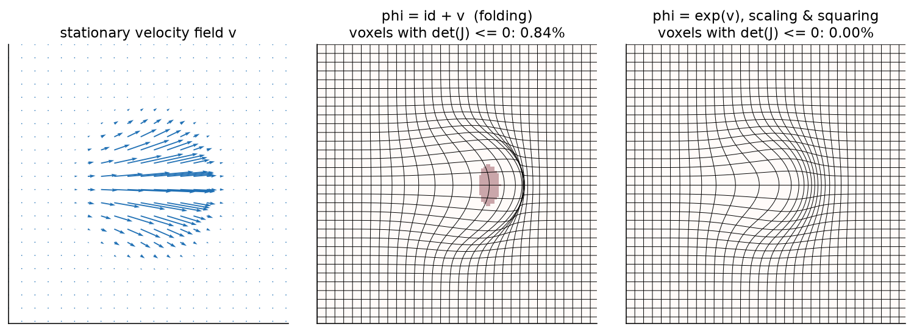

# Method

Each step of the pipeline, with the module that implements it. Citation keys refer to
[`REFERENCES.md`](../REFERENCES.md). The network itself is described in [`architecture.md`](architecture.md), the
memory optimizations in [`gpu_memory.md`](gpu_memory.md).

## 1. Network and velocity head

`registration/model.py`.

- MONAI `SwinUNETR` ([hatamizadeh2022swinunetr](../REFERENCES.md#hatamizadeh2022swinunetr)) with 2 input channels
  (moving and fixed image concatenated), `feature_size = 48`, 16 output channels; 62.2 M parameters.
- The encoder starts from the MONAI self-supervised weights
  ([tang2022selfsupervised](../REFERENCES.md#tang2022selfsupervised)), whose 1-channel patch embedding is copied to the
  2 input channels and divided by 2.
- Velocity head: `Conv3d(16 -> 3, kernel 3)` (1299 parameters), initialized to ~0 so that the initial deformation is
  the identity. Its output is a stationary velocity field `v` in voxels.

## 2. Diffeomorphic integration and warping

`registration/model.py` (`ScalingAndSquaring`, `SpatialTransformer3D`), `registration/metrics.py`.

- Scaling and squaring ([arsigny2006logeuclidean](../REFERENCES.md#arsigny2006logeuclidean),
  [dalca2019diffeomorphic](../REFERENCES.md#dalca2019diffeomorphic)): `u = v / 2^N`, then `N` times
  `u <- u + u o (x + u)`, with `N = 9`, as in DARTEL ([ashburner2007dartel](../REFERENCES.md#ashburner2007dartel)). The result
  approximates `exp(v)`, a diffeomorphism when `v` is smooth.
- Warping ([jaderberg2015stn](../REFERENCES.md#jaderberg2015stn)): `grid_sample` at `x + u(x)` with
  `align_corners=True` and border padding; trilinear for images and masks, nearest for integer labels.
- Folding: percentage of voxels with `det(J) <= 0`, `J = I + grad(u)`, computed with central differences.

*2D example: using the velocity directly as displacement folds the grid, its exponential does not.*

## 3. Losses

`registration/losses.py`, `registration/training.py`.

- **Local NCC**: squared Pearson correlation between fixed and warped image in a 7³ window around each voxel,
  averaged over the fixed lung mask, `L = -mean_mask(cc)`. Window sums are computed with a separable box filter
  (three 1D convolutions) and in float32, because local variances are differences of large sums. It is the standard
  similarity of learning-based monomodal registration ([balakrishnan2019voxelmorph](../REFERENCES.md#balakrishnan2019voxelmorph)).
- **MIND** ([heinrich2012mind](../REFERENCES.md#heinrich2012mind)): for 12 neighbour offsets `r`,
  `D(x, r) = G_3 * (I - I(. - r))²`, `MIND(x, r) = exp(-D / (h² V(x)))` with `V` the mean of `D` over the offsets and
  `h = 0.3`. The loss is the mean squared difference of the descriptors. MIND depends on local structure, not on the
  absolute intensities, so it suits CT-to-CBCT registration; its voxel-wise error map also drives the local stage of
  the TTO.
- **Multiscale similarity**: NCC and MIND at full and half resolution,
  `L_sim = (NCC_100 + NCC_50) / 2 + 0.5 (MIND_100 + MIND_50) / 2`.
- **Smoothness**: diffusion regularizer, the mean squared forward difference of the DVF over voxels, components and
  axes. `smoothness_map` gives the voxel-wise version used by the TTO.
- **Soft Dice** of the lung masks: the binary moving mask is warped trilinearly, so the Dice has a non-zero gradient
  with respect to the DVF (`DIFFERENTIABLE_DICE = True`). Label supervision of this kind follows
  [hu2018weakly](../REFERENCES.md#hu2018weakly).
- **Inverse consistency** ([christensen2001consistent](../REFERENCES.md#christensen2001consistent)): with `u_inv`
  integrated from `-v`, the composition `u + u_inv o (x + u)` should vanish; its mean square is penalized (see also
  [zhang2018icnet](../REFERENCES.md#zhang2018icnet)).
- **Points**: mean landmark error in mm, and smooth L1 of the keypoint error in mm, sampled from the DVF at the fixed
  points.

Training loss, with epoch-dependent weights following a linear curriculum `λ(e) = a + (b - a) min(1, e / (E - 1))`:

`L = L_sim + λ_s(e) R(u) + 0.4 L_Dice + 0.5 L_inv + λ_lm(e) L_lm + λ_kp(e) L_kp`

Evaluation metrics: TRE (mean landmark error in mm, DVF brought to the native grid and interpolated with cubic
splines), Dice, HD95 and mean surface distance, centroid shift, folding.

## 4. Training

`registration/training.py` (`PhaseConfig`, `train_phase`), notebook sections 3-5, logs in `results/training/`.

- Data: Learn2Reg lung CT ([hering2022learn2reg](../REFERENCES.md#hering2022learn2reg)), intra-patient pairs
  expiration (moving) to inspiration (fixed), clipped to the 1st-99th percentile, scaled to [-1, 1] and resampled to
  192³ (`align_corners=True`, nearest for labels). Validation: patients 0001-0003. Training: the other 17, doubled with
  the inverted pairs (34 pairs). Resampled volumes are cached on disk with a hash of their source files.
- GPU augmentation: Y flip, rigid motion (the same transform on moving and fixed: an independent one would add fake
  relative motion), Gaussian noise, contrast, bias field, low resolution.
- **Warmup** (30 epochs): Swin transformer frozen except the patch embedding, Adam
  ([kingma2015adam](../REFERENCES.md#kingma2015adam)) 1e-4.
- **Finetune** (up to 300 epochs, patience 40): whole network, AdamW with 2e-5 on the transformer and 1e-4 on the
  rest, weight decay 1e-4 ([loshchilov2019adamw](../REFERENCES.md#loshchilov2019adamw)). Two further phases changed only the augmentation:
  finetune D restarts from the best finetune model and applies the same rigid motion to moving and fixed, finetune E
  also widens rotations and translations (`results/training/finetune_D.txt`, `finetune_E.txt`).
- Learning rate: linear warmup then cosine decay ([loshchilov2017sgdr](../REFERENCES.md#loshchilov2017sgdr)),
  (warmup epochs, total epochs, minimum ratio) = (3, 30, 0.1) and (5, 300, 0.01).
- Batch 1 with 6 accumulation steps, gradient clipping at 1.0, bfloat16 autocast.
- Model selection on the validation TRE, never used for the gradient. A resume checkpoint (model, optimizer,
  scheduler, best TRE, patience) is written in a background thread with atomic saves, so an interrupted run restarts
  from the last epoch.

## 5. Test-time optimization

`registration/tto.py` (`TTOConfig`, `run_tto`), notebook sections 6, 7 and 9.

- Per-pair optimization (instance optimization, see [zhang2024gradientprojection](../REFERENCES.md#zhang2024gradientprojection))
  that starts from the trained weights each time. With `freeze_backbone=True` every SwinUNETR parameter (encoder,
  decoder and its 1×1×1 output convolution, 62,189,122 parameters) is frozen and only the 3×3×3 velocity head
  `reg_head` (1,299 parameters) is optimized; the network has no normalization layer with running statistics and no
  dropout, so the frozen part is a fixed function of the input. With `False` all 62,190,421 parameters are optimized.
- **Global stage**: MIND error weighted by `1 + 50 · 1[T]`, with `T` the tumor expanded by 10 mm, plus lung Dice,
  smoothness and the optional structure terms. **Local stage** (from `switch_step`): the MIND error map is frozen and
  becomes a residual weight from 1 to 4 (`residual_weight_amplitude = 3`), which multiplies MIND and smoothness, so
  the regions still misaligned weigh more. Lung and tumor Dice weights are pairs (global; local). With the 4D-Lung
  configuration (`n_steps = switch_step = 100`) the local stage is not reached.
- **Body mask** (`build_lcc_mask`): Gaussian smoothing, HU threshold, per-slice closing and hole filling, largest
  connected component. With `mask_dvf=False` (4D-Lung case) it only confines the loss, so the DVF stays continuous at
  the skin; `mask_dvf=True` also sets the DVF to zero outside the body. The notebook uses a −500 HU threshold; the
  reported 4D-Lung runs used −900 HU.
- **Structure supervision** (4D-Lung case study): all ROIs present in both the moving and the fixed RTSTRUCT are
  rasterized on the network grid in one bfloat16 tensor. The union of the lung lobes replaces the lung mask, the tumor
  has its own Dice (weight 4), the organs a mean Dice (weight 4) and the bones (vertebrae, ribs, sternum, scapulae,
  clavicles) a mean Dice (weight 2). The fixed labels are always the structures of the real CT, also when the fixed
  image is the CBCT, because the CBCT has no contours (see *Contours* in [`data/README.md`](../data/README.md)).
  Deformable registration of 4D-CT to 4D-CBCT on the same collection was evaluated by
  [balik2013_4dct_4dcbct](../REFERENCES.md#balik2013_4dct_4dcbct).
- **Overfitting control**: smaller vessels, left atrial appendage, deep back muscles, costal cartilage and right ribs
  1-7 are held out of the loss; their Dice is only logged and is an independent check of the structures in the loss.
- **Bone rigidity**: bones enter their own Dice term and the mean `|log det J|` inside the bones is logged as a measure
  of how far the deformation is from rigid there. There is no dedicated rigidity penalty.
- Regularization weight chosen on the validation patients (`lambda_reg = 0.5`, notebook section 7).

## 6. Automatic keypoints

`registration/keypoints.py`, notebook section 8.

Förstner corners ([forstner1987](../REFERENCES.md#forstner1987)) on the moving image inside the eroded lung mask:
structure tensor `S = G_2 * (∇I ∇Iᵀ)` with Gaussian derivatives (σ = 1), strength `det S / tr S` and isotropy
`4 det S / (tr S)²`, local maxima at least 4 voxels apart. Each point is matched by NCC block matching (9³ patch,
±10 voxel search, NCC ≥ 0.3) in the fixed image, on the GPU in groups of 256 points. Points are saved with the file
convention the dataset reads.

## 7. Warped structures and mass-preserving HU correction

`registration/postprocessing.py`, notebook section 9.1.

- The DVF is interpolated onto the native grid and each component is rescaled from network voxels to native voxels
  (`dvf_to_native_resolution`); it can be saved as a vector NIfTI (`export_dvf_nifti`).
- Structures are warped as binary masks with trilinear interpolation and thresholded at 0.5.
- With `ρ ∝ HU + 1000`, mass conservation gives `HU_F(x) = (HU_M(x + u) + 1000) det J(x) - 1000`. The correction is
  applied only inside the warped lung, tumor excluded (soft tissue is nearly incompressible), with `det J` clamped to
  [0.5, 2]. Outside the body mask of the fixed image the CT is set to -1000 HU and the mask is exported as `BODY`.
- `mass_diagnostics` compares the mean HU of the inner lung (eroded by 2 voxels) before and after the correction with
  the real fixed CT and with the value expected from the volume change.

## 8. DICOM CT and RTSTRUCT export

`registration/dicom_export.py`, notebook section 9.2.

- The warped CT is put on the grid of the real CT and written as a DICOM series that copies every tag of the real CT
  (including `FrameOfReferenceUID`) except pixel data and UIDs, with HU converted back through `RescaleSlope` and
  `RescaleIntercept`. The synthetic CT is therefore aligned voxel by voxel with the reference.
- `create_rtstruct` writes an RT Structure Set that references the new series. For each structure and slice: a 2 × 2
  morphological opening, marching squares contours, Douglas-Peucker simplification (0.5 pixel) and conversion to
  patient coordinates with `ImagePositionPatient` and `ImageOrientationPatient`. Names and colours come from the moving
  RTSTRUCT; the tumor is typed `GTV`, the others `ORGAN`.
- With `EXPORT_NO_JACOBIAN_CT = True` the CT without the HU correction is exported too.

In the reported 4D-Lung experiments the correction was applied to one registered dose only:

| Experiment | `dir_ct` | `dir_cbct` |
|---|---|---|
| `frozen_backbone` | corrected HU (`CT_Warped_TTO`) | uncorrected HU (`CT_Warped_TTO_noJac`) |
| `full_network` | uncorrected HU (`CT_Warped_TTO_noJac`) | uncorrected HU (`CT_Warped_TTO_noJac`) |

The RTDOSE files exported by matRad do not reference their CT series; the link comes from the matRad input of each
dose (`ct.cubeHU` of `patient_<case>.mat`), which is identical voxel by voxel to the CT series stored with it, whose
SeriesDescription is given in the table. `real_ct` and `baseline` are original CTs, to which the correction does not
apply.

## 9. Dose recalculation in matRad

`matlab/`, `registration/dose_analysis/build_structures.py`.

`build_structures.py` derives the planning structures from the TotalSegmentator RTSTRUCTs
([wasserthal2023totalsegmentator](../REFERENCES.md#wasserthal2023totalsegmentator)): PTV = GTV + 5 mm, lungs minus GTV,
spinal cord PRV + 5 mm, total heart, great vessels, chest wall, a 10-30 mm ring around the PTV and BODY. matRad
([wieser2017matrad](../REFERENCES.md#wieser2017matrad)) optimizes one SBRT plan on the real CT. The same beams and
weights are then used to recompute the dose on the baseline CT, on the DIR-warped CT and on the DIR-warped CBCT. Plan
report: `results/dosimetry/treatment_plan.txt`.

## 10. Gamma index and DVH

`registration/dose_analysis/dose_analysis.py`.

- Global gamma ([low1998gamma](../REFERENCES.md#low1998gamma)) computed with pymedphys
  ([biggs2022pymedphys](../REFERENCES.md#biggs2022pymedphys)) at 3%/3 mm, 3%/2 mm, 2%/2 mm and 1%/1 mm, with a low-dose
  cutoff of 10% of the reference maximum, against the dose on the real CT (`real_ct`).
- 2%/2 mm gamma inside each reference structure and in dose regions (≥ 10%, 50%, 80% of the maximum).
- Geometry of each structure against the real CT: Dice, HD95, mean surface distance, centroid shift.
- DVH metrics on each dose with its own structures: D98, D95, D50, D2 for GTV and PTV
  ([icru91](../REFERENCES.md#icru91)); D2, V1Gy and V2Gy for the lungs; D2 and D0.03cc for the other organs.
