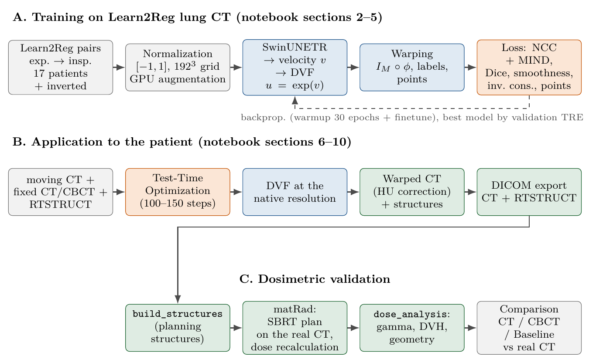

# Pipeline

The diagrams in this folder are built from their LaTeX sources, for example
`pdflatex pipeline.tex && pdftoppm -r 220 -png -singlefile pipeline.pdf pipeline`. The plots are written by
`scripts/figures/make_plots*.py` from `results/`, the 4D-Lung figures by `make_case_figures.py` (see
[`scripts/README.md`](../scripts/README.md)).

## Stages, code and outputs

| Stage | Where | Input | Output |
|---|---|---|---|
| Training (warmup + finetune) | `notebooks/main.ipynb` sections 3-4 | Learn2Reg lung CT | `weights/best_reg_model.pth`, TensorBoard runs, `results/training/` |
| Keypoint diagnostic | section 5 | trained weights | `results/training/keypoint_diagnostic.txt` |
| TTO on validation and test pairs | sections 6-7 | trained weights | `results/tto/tto_validation_test.txt`, `results/tto/tto_regularization_study.txt` |
| Automatic keypoints | section 8 | Learn2Reg test pairs | keypoint CSVs, `results/keypoints/` |
| Registration of one pair | `scripts/register_pair.py` | moving and fixed NIfTI, trained weights | warped image, DVF, det J statistics |
| TTO with RTSTRUCT structures | section 9 | 4D-Lung pair, RTSTRUCTs | DVF (NIfTI) |
| HU correction, DICOM / RTSTRUCT export | sections 9.1-9.2 | DVF, real CT DICOM series | `outputs/dir_cbct/ct/`, `outputs/dir_cbct/rtstruct/` (and `dir_cbct_no_jacobian/`) |
| GPU memory profiling | section 10 | section 9 state | `results/vram_profiling/` |
| Planning structures | `scripts/build_structures.py` | CT slices + TotalSegmentator RTSTRUCT | `RTSTRUCT_TPS/TPS_<name>.dcm` |
| Plan and dose recalculation | `matlab/` (matRad) | `patient_<case>.mat` | `<case>_dose.mat`, `<case>_dicom/` |
| Dosimetric comparison | `scripts/dose_analysis.py` | `RTDose_<case>.dcm`, `RTstruct_<case>.dcm` | `results/` folder of CSVs, `analysis_summary.txt`, PNGs; reported runs in `results/dosimetry/` |

The export paths are named after the CBCT case (`dir_cbct`). For the CT case, run section 9 with the CT of the day as
the fixed image and change the export paths.

## The 4D-Lung case study

Sections 9 and 10 use subject `107_HM10395` of the public TCIA collection 4D-Lung (CC BY 3.0): the planning CT
(series S300, moving image, `baseline`), a later CT (series S302) and a CBCT (series S107), all at the 0% phase of
their 4D acquisition. The later CT is both the fixed image of the CT case and the reference of the dosimetric comparison
(`real_ct`); the CBCT is the fixed image of the CBCT case. The images are read from `data/clinical/4dlung_107/images/`
and named after `CLINICAL_CASE = "4dlung_107"` (first code cell of the notebook). Series, download and contours:
[`data/README.md`](../data/README.md).

For the CBCT the TTO uses the structures of the real CT as fixed labels (`RTSTRUCT_FIX_DIR`), because 4D-Lung has no
contours on the CBCT: see the limitations in the README.

## Case names of the dosimetric comparison

| Name | Dose computed on |
|---|---|
| `real_ct` | the real CT of the day, with the plan optimized on it (reference) |
| `dir_ct` | the planning CT warped onto the CT of the day by the registration |
| `dir_cbct` | the planning CT warped onto the CBCT of the day by the registration |
| `baseline` | the planning CT without registration |

`dose_analysis.py` writes to `<input_dir>/results` unless `--output_dir` is given; `--reference` and `--evaluated`
accept other case names.
