# Additional result figures

Figures that complement the tables of the README. Numbers in the captions come from `results/case_figures.json`
(4D-Lung figures) and the other files of `results/`. Image panels are axial or coronal slices in radiological view
(patient right on the image left, head at the top of coronal views).

## Learn2Reg lung CT

Plots of the training and test-time optimization logs; no image of the data is shown.

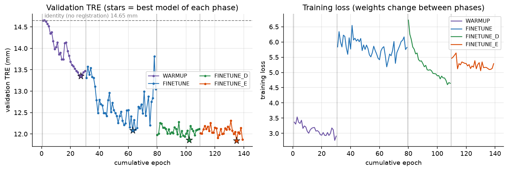

*Validation TRE and training loss of the four training phases (`results/training/`).*

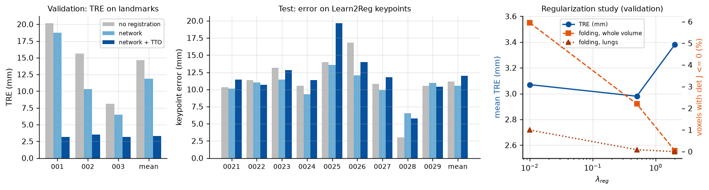

*GPU runs of `results/tto/`: the TTO lowers the validation TRE to about 3 mm but does not reduce the keypoint error on
the test pairs; a smoothness weight of 0.5 removes most of the folding inside the lungs.*

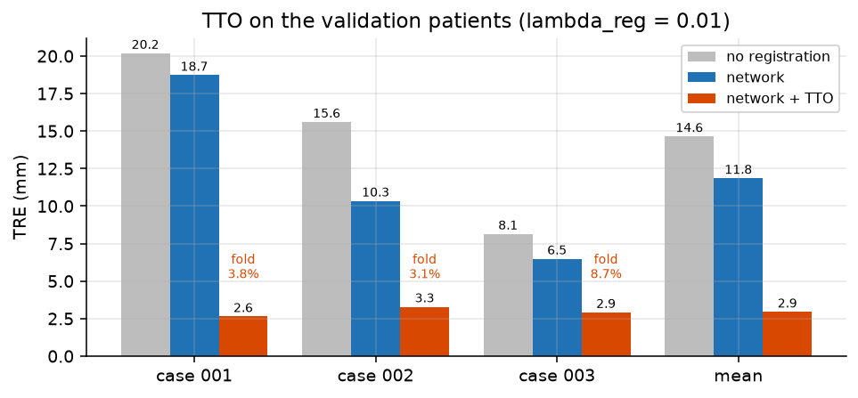

*TRE of the three validation patients without registration, with the network and after TTO (GPU runs).*

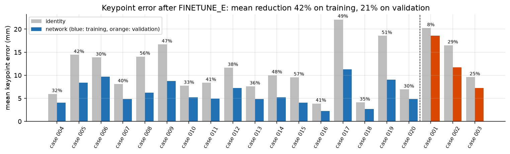

*Keypoint error of the trained network on training and validation pairs (`results/training/keypoint_diagnostic.txt`).*

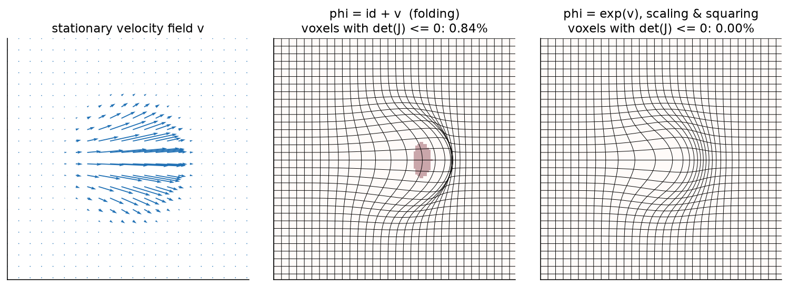

*2D example: using the velocity directly as displacement folds the grid, its exponential does not.*

## 4D-Lung case study

All panels: Data: 4D-Lung, TCIA (CC BY 3.0), subject 107_HM10395
([hugo2016_4dlung_data](../REFERENCES.md#hugo2016_4dlung_data)). The GTV is the expert contour of 4D-Lung; spinal
cord, lungs and the other organs at risk are TotalSegmentator contours.

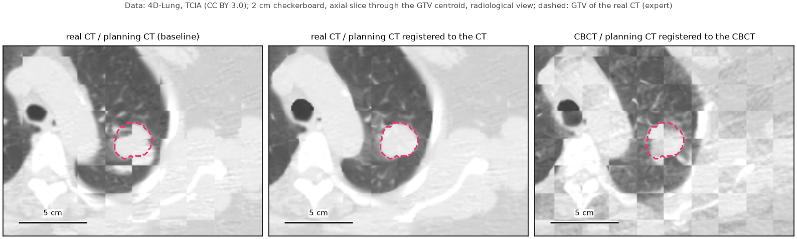

*2 cm checkerboards of the real CT with the planning CT (left: edges of the tumor and vessels break across the tiles),
with the planning CT registered to the CT (centre: edges continue) and of the CBCT with the planning CT registered to
the CBCT (right). Dashed: GTV of the real CT (expert contour).*

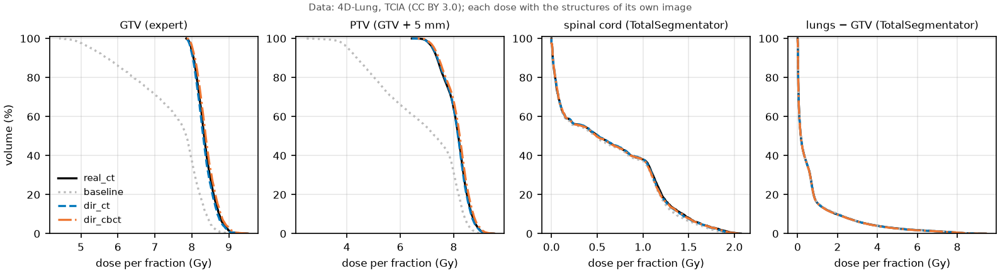

*Cumulative DVHs of the `full_network` experiment, each dose with the structures of its own image. The baseline curve
of the GTV and PTV falls well below the others; the registered CT and CBCT follow the real CT.*

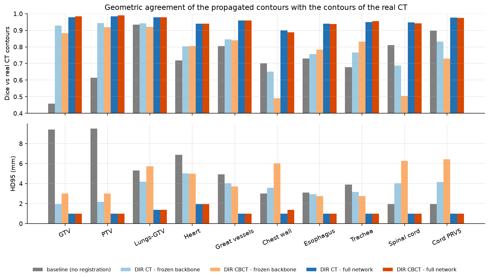

*Dice and HD95 of the propagated structures against those of the real CT, both experiments
(`results/dosimetry/<run>/geometry_vs_reference.csv`).*

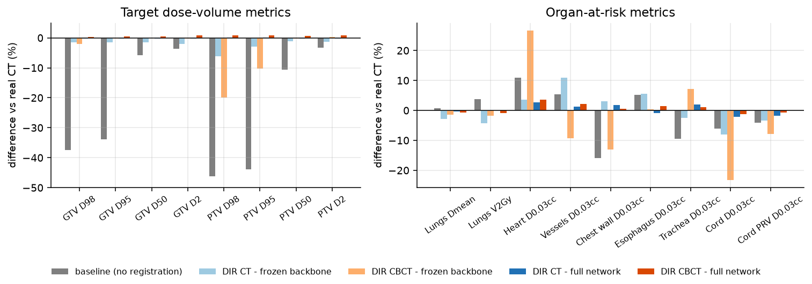

*Relative differences of the target and organ-at-risk metrics against the dose on the real CT
(`results/dosimetry/<run>/dvh_metrics.csv`).*

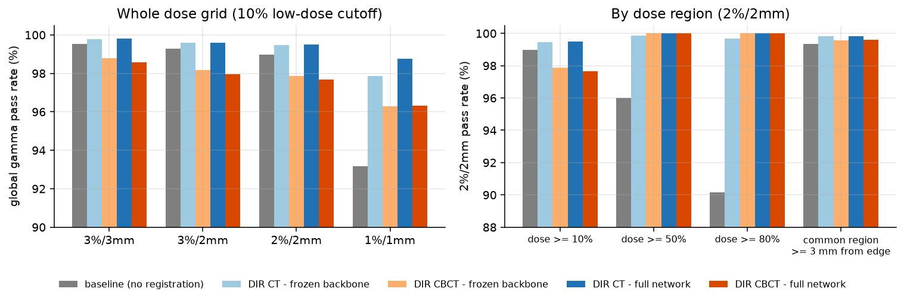

*Global gamma pass rates on the whole dose grid and by dose region (`gamma_results.csv`, `dose_comparison_regions.csv`).*

## GPU memory

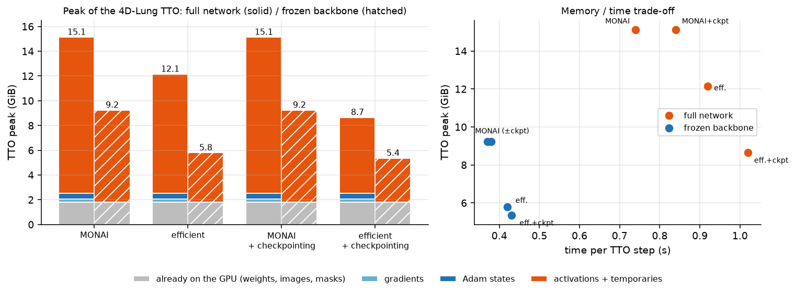

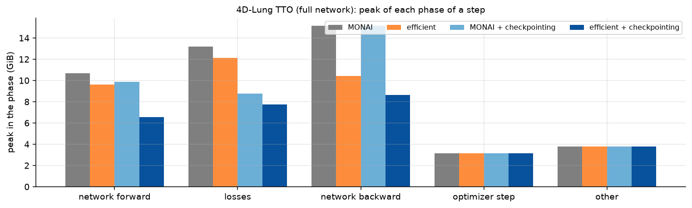

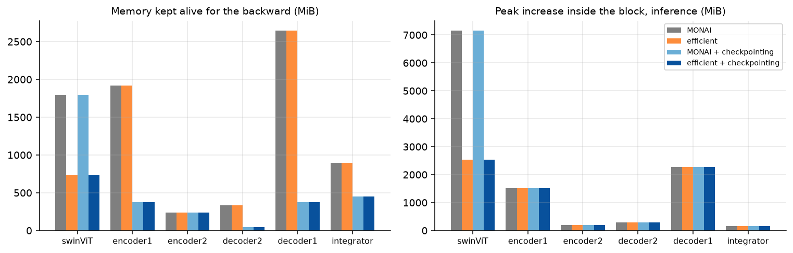

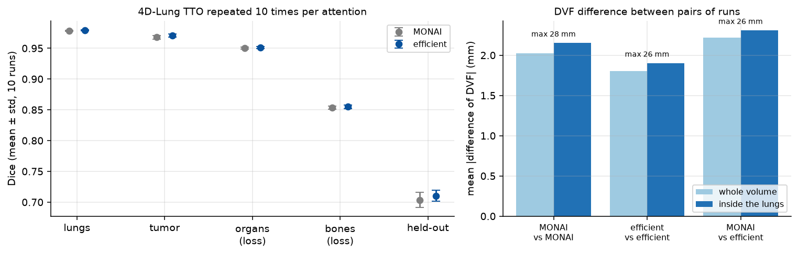

*NVIDIA A100, 448 × 288 × 32 grid of the 4D-Lung case (`results/vram_profiling/`, [`gpu_memory.md`](gpu_memory.md)).*
